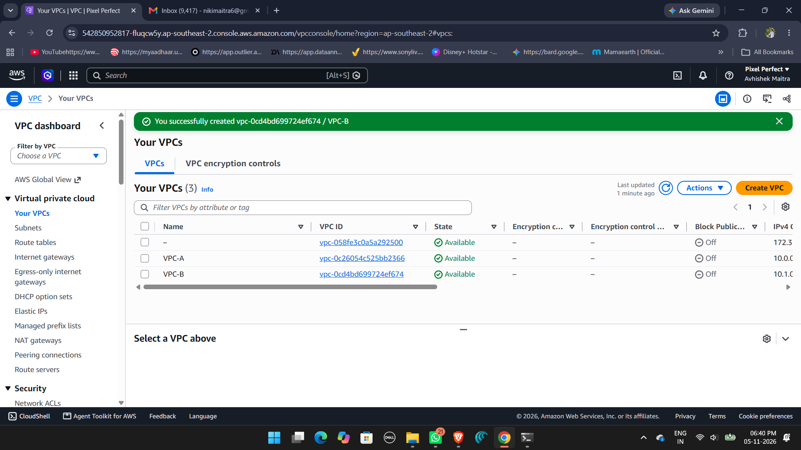
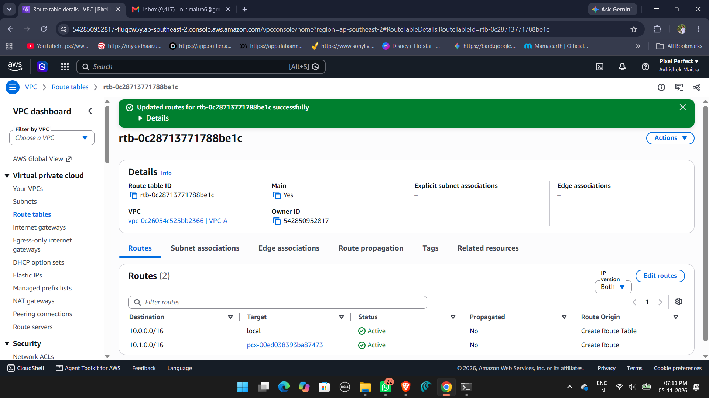
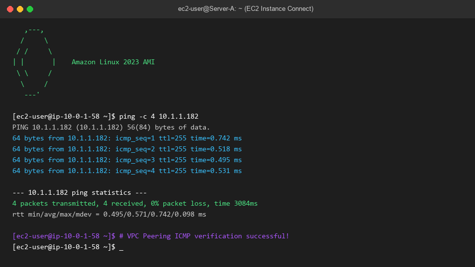

# AWS VPC Peering Architecture — AWS Internship Batch 1

    **Author:** Avhishek Maitra
    **Batch:** AWS Internship Batch 1
    **Project:** Cross-VPC Peering Connection & Connectivity Verification
    **Status:** Completed & Verified

    ---

    ## 📌 Executive Summary
    This project implements a secure, high-performance **AWS VPC Peering Connection** between two
    distinct Virtual Private Clouds (**VPC-A** and **VPC-B**) provisioned with non-overlapping IPv4
    CIDR blocks.

    VPC Peering facilitates private, direct network communication between compute resources across
    VPC boundaries without routing through the public internet.

    ---

    ## 🏗️ Architecture Diagram

  +---------------------------------------------------+         +----------------------------------
  -----------------+
  |                 VPC A (Requester)                 |         |                 VPC B (Accepter)
  |
  |                 CIDR: 10.0.0.0/16                 |         |                 CIDR: 10.1.0.0/16
  |
  |                                                   |         |
  |
  |   +-------------------------------------------+   |         |   +------------------------------
  -------------+   |
  |   | Subnet A (Public): 10.0.1.0/24            |   |         |   | Subnet B (Public):
  10.1.1.0/24            |   |
  |   |   [Server-A (Amazon Linux)]               |<===========>|   |   [Server-B (Amazon Linux)]
  |   |
  |   +-------------------------------------------+   | Peering |   +------------------------------
  -------------+   |
  |                        |                          | (Active)|                        |
  |
  |                 Route Table A                     |         |                 Route Table B
  |
  |         10.1.0.0/16  -> pcx-peering-id (Peer)     |         |         10.0.0.0/16  -> pcx-
  peering-id (Peer)     |
  +---------------------------------------------------+         +----------------------------------
  -----------------+

    ---

    ## ⚙️ Network Configuration Specifications

    | Parameter | VPC A (Requester) | VPC B (Accepter) |
    |:---|:---|:---|
    | **VPC Name** | `VPC-A` | `VPC-B` |
    | **VPC CIDR** | `10.0.0.0/16` | `10.1.0.0/16` |
    | **Subnet Name** | `Subnet-A` | `Subnet-B` |
    | **Subnet CIDR** | `10.0.1.0/24` | `10.1.1.0/24` |
    | **Peering Connection** | `Peering-VPC-A-to-B` (Active) | `Peering-VPC-A-to-B` (Active) |
    | **Route to Peer** | `10.1.0.0/16` via Peering Connection | `10.0.0.0/16` via Peering
    Connection |

    ---

    ## 📸 Verification Evidence & Screenshots

    ### 1. Dual VPC Creation (VPC-A & VPC-B)
    

    ### 2. Active VPC Peering Connection
    

    ### 3. Route Table with VPC Peering Target Configured
    

    ### 4. Successful Cross-VPC ICMP Ping Test
    
