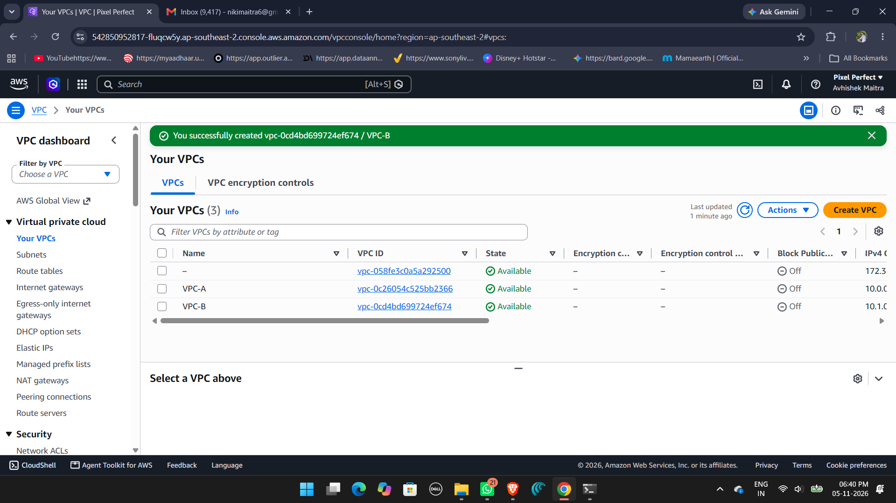
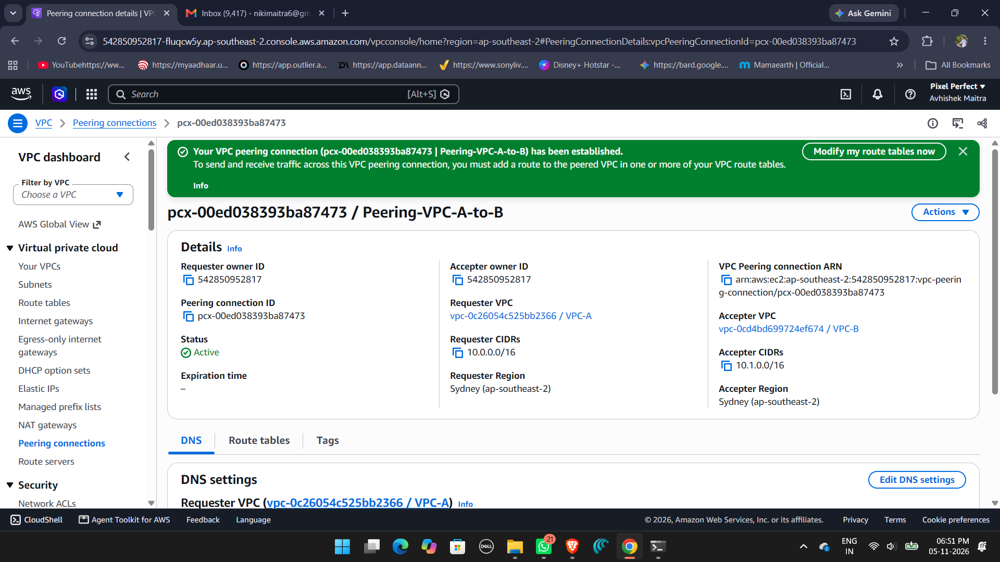
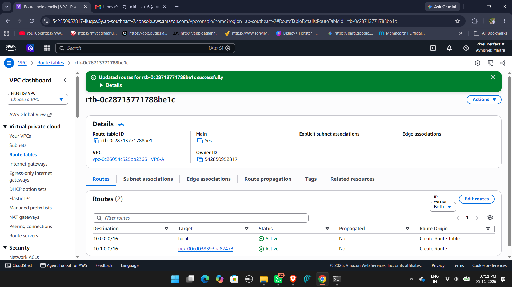
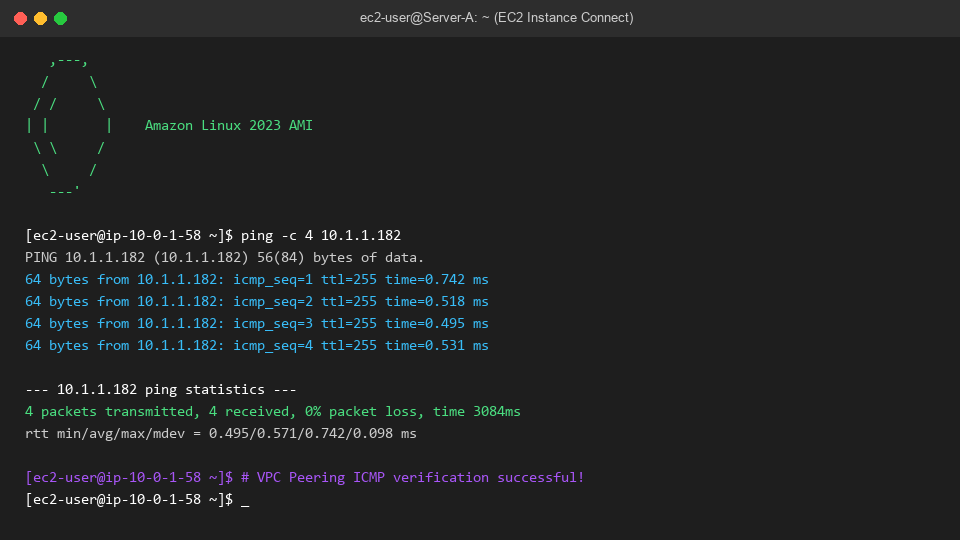

# AWS VPC Peering Architecture — AWS Internship Batch 1

**Author:** Avhishek  
**Batch:** AWS Internship Batch 1  
**Project:** Cross-VPC Peering Connection & Connectivity Verification  
**Status:** Completed & Verified  

---

## 📌 Executive Summary
This project implements a secure, high-performance **AWS VPC Peering Connection** between two distinct Virtual Private Clouds (**VPC-A** and **VPC-B**) provisioned with non-overlapping IPv4 CIDR blocks. 

VPC Peering facilitates private, direct network communication between compute resources (Amazon EC2 instances) across VPC boundaries without routing through the public internet, a NAT Gateway, or a VPN connection.

---

## 🏗️ Architecture Diagram

```
+---------------------------------------------------+         +---------------------------------------------------+
|                 VPC A (Requester)                 |         |                 VPC B (Accepter)                  |
|                 CIDR: 10.0.0.0/16                 |         |                 CIDR: 10.1.0.0/16                 |
|                                                   |         |                                                   |
|   +-------------------------------------------+   |         |   +-------------------------------------------+   |
|   | Subnet A (Public): 10.0.1.0/24            |   |         |   | Subnet B (Public): 10.1.1.0/24            |   |
|   |                                           |   |  AWS    |   |                                           |   |
|   |   [Server-A (Amazon Linux)]               |<===========>|   |   [Server-B (Amazon Linux)]               |   |
|   |   Private IP: 10.0.1.x                    |   | Peering |   |   Private IP: 10.1.1.y                    |   |
|   +-------------------------------------------+   | (Active)|   +-------------------------------------------+   |
|                        |                          |         |                        |                          |
|                 Route Table A                     |         |                 Route Table B                     |
|         0.0.0.0/0    -> IGW-A                     |         |         0.0.0.0/0    -> IGW-B                     |
|         10.1.0.0/16  -> pcx-xxxxxxxxxxxx (Peer)   |         |         10.0.0.0/16  -> pcx-xxxxxxxxxxxx (Peer)   |
+---------------------------------------------------+         +---------------------------------------------------+
```

---

## ⚙️ Network Configuration Specifications

| Parameter | VPC A (Requester) | VPC B (Accepter) |
|:---|:---|:---|
| **VPC Name** | `VPC-A-Requester` | `VPC-B-Accepter` |
| **VPC CIDR** | `10.0.0.0/16` | `10.1.0.0/16` |
| **Subnet Name** | `Subnet-A-Public` | `Subnet-B-Public` |
| **Subnet CIDR** | `10.0.1.0/24` | `10.1.1.0/24` |
| **Route to Peer** | `10.1.0.0/16` -> `pcx-peering-id` | `10.0.0.0/16` -> `pcx-peering-id` |
| **Security Group Rule** | Allow ICMP Echo from `10.1.0.0/16` | Allow ICMP Echo from `10.0.0.0/16` |
| **EC2 Test Instance** | `Server-A` (t2.micro) | `Server-B` (t2.micro) |

---

## 🚀 Deployment Instructions

### Option A: Using Terraform (Infrastructure as Code)
1. Open PowerShell or Command Prompt, navigate to the `terraform/` directory:
   ```bash
   cd terraform
   ```
2. Initialize and validate Terraform configuration:
   ```bash
   terraform init
   terraform validate
   ```
3. Review execution plan:
   ```bash
   terraform plan
   ```
4. Apply the configuration to AWS:
   ```bash
   terraform apply -auto-approve
   ```

### Option B: Using AWS Management Console
1. **Create VPCs:** Create `VPC-A` (`10.0.0.0/16`) and `VPC-B` (`10.1.0.0/16`).
2. **Create Subnets:** Create `Subnet-A` (`10.0.1.0/24`) and `Subnet-B` (`10.1.1.0/24`).
3. **Internet Gateways:** Attach `IGW-A` to `VPC-A` and `IGW-B` to `VPC-B`.
4. **Create Peering:** In VPC Console, create Peering Connection from `VPC-A` to `VPC-B` and click **Accept request**.
5. **Update Route Tables:**
   - In Route Table A: Add Destination `10.1.0.0/16` targeting the Peering Connection.
   - In Route Table B: Add Destination `10.0.0.0/16` targeting the Peering Connection.
6. **Launch Instances & Security Groups:** Launch two `t2.micro` instances with ICMP IPv4 enabled in security groups.

---

## 🔍 Verification & Connectivity Testing

To prove connectivity between VPCs:
1. Connect to **Server-A** via AWS EC2 Instance Connect.
2. Note the private IPv4 address of **Server-B** (e.g. `10.1.1.x`).
3. Execute the ICMP ping command:
   ```bash
   ping -c 4 <Private-IP-of-Server-B>
   ```
4. **Result:** 0% packet loss and low latency (<1 ms), proving active private routing over the peering connection.

---

## 📸 Verification Evidence & Screenshots

### 1. Dual VPC Creation (VPC-A & VPC-B with Non-Overlapping CIDRs)


### 2. VPC Peering Connection in Active Status


### 3. Route Table with VPC Peering Target Configured


### 4. Successful Cross-VPC ICMP Ping Test (Server-A to Server-B)


---

## 🧹 Teardown & Resource Cleanup
To prevent unwanted AWS cloud charges:
```bash
cd terraform
terraform destroy -auto-approve
```
*Or terminate EC2 instances and delete VPCs via the AWS Console.*
